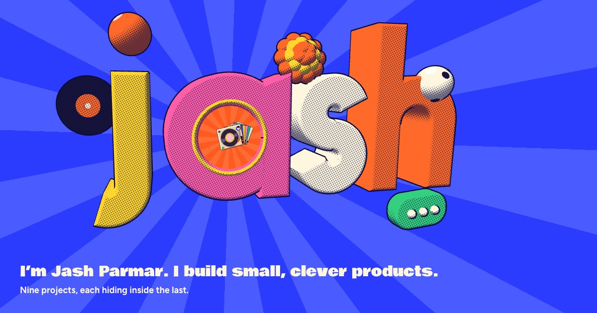

# jashparmar.com

My portfolio, live at **[jashparmar.com](https://jashparmar.com)**.

It is one picture you can keep falling into. Scroll into the hole in the "a" of my name and you land in a record player. Its label holds a clothes rail, the T-shirt on it holds a chat bubble, and so on through nine projects. The last world is a desk whose screen shows the first, so it never ends.

- **Nine projects, nine small games.** Scratch the record, sort the bars, catch the double booking. Each one stamps a card, and none of them blocks the content.
- **Cats.** A desk cat that can be stroked, fed, teased with a laser and will push your mug off the desk if ignored. Nine kittens hide in the other worlds.
- **[Cat room](https://jashparmar.com/cats):** every cat in one room, with yarn, treats and cardboard boxes.
- **[Print shop](https://jashparmar.com/print):** turns a photo into a two-ink comic print, entirely on your device.
- **[Your name in print](https://jashparmar.com/name):** your name as 3D letters, with a shareable link.

## How it works

Plain HTML, CSS and JavaScript modules, with [three.js](https://threejs.org) r170. No framework and no bundler.

- **Endless zoom.** Every world is a separate scene at its own scale. Each one is ten times smaller than the last, drawn through a stencil portal, so precision never runs out and up to three worlds are visible at once.
- **The print look.** One small shader gives every surface two inks with a halftone between them. The dots are anchored to the picture, so they grow as you fall. Outlines are inverted hulls.
- **Layout by measuring.** Each world's text is measured, shortened a step at a time if space is tight, and the world is then framed inside whatever is left. Portrait, landscape phones, tablets and desktops share that one path.
- **Speed.** Everything is sent to the graphics chip before the first frame, crowds are instanced, and resolution drops by itself if a device struggles.
- **Without 3D.** The page falls back to readable text, and reduced motion is respected.

## Files

| File | What it does |
|---|---|
| `index.html` | Home page, with a plain-text version for readers and crawlers |
| `z/app.js` | Travel, layout, text, stamps and pointer handling |
| `z/ink.js` | The print shader, outlines, geometry helpers and the `World` class |
| `z/worlds.js` | The eleven worlds and their games |
| `z/cats.js` | The desk cat and the kittens |
| `z/stage.js` | Shared camera and loop for the extra pages |
| `z/catroom.js`, `z/print.js`, `z/name.js` | The three extra pages |
| `z/content.js` | Projects, experience and links |
| `pages/` | Templates and the small script that builds `cats.html`, `print.html` and `name.html` |

Run it with any static server, for example `python3 -m http.server`, then open `/index.html`. The extra pages are `/cats.html`, `/print.html` and `/name.html` locally.

## Credits

three.js is MIT licensed. The 3D letters on the name page use outlines from Bowlby One by Vernon Adams, under the SIL Open Font License (`z/OFL-BowlbyOne.txt`).

The previous site, Assembly, is in this repository's history.
